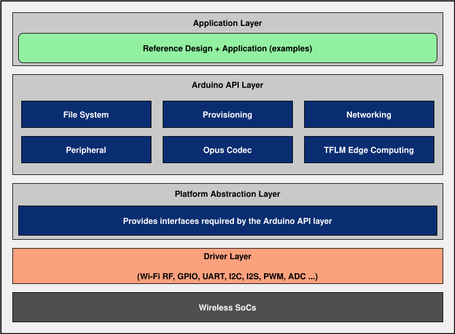

# tl_arduino_wifi_sdk README

* [English](./README.md)

## SDK 简介

tl_arduino_wifi_sdk 是一款面向物联网应用的软件开发套件，基于泰凌 ML9118A 系列模组，提供网络通信能力及相关开发支持，帮助开发者完成从原型验证到产品开发的完整流程。

本 SDK 集成底层硬件驱动、网络协议、系统服务及相关软件组件，支持 Wi-Fi 物联网产品及项目开发。

**核心能力**

| **类别** | **能力** |
| --- | --- |
| **无线连接能力** | 支持 Wi-Fi 连接 |
| **硬件驱动能力** | 提供 Wi-Fi 射频、GPIO、UART、I2C、ADC、PWM、I2S 等外设驱动 |
| **网络通信能力** | 支持 TCP/IP、HTTP/HTTPS、MQTT、WebSocket 等网络协议 |
| **系统中间件能力** | 提供 LittleFS、配网服务、Opus 编解码、TensorFlow Lite for Microcontrollers（TFLM）等组件 |
| **开发资源** | 提供多种示例代码 |
| **系统功能** | 提供存储管理等系统功能 |

您可基于本 SDK 开发多种无线物联网产品，覆盖智能家居、音频 IoT 等应用领域。

**典型应用**

| **应用领域** | **典型产品** |
| --- | --- |
| Wi-Fi 智能家居设备 | 智能照明、智能插座、环境传感器、智能门锁等 |
| 音频类 IoT 产品 | 录音卡、录音笔、智能音箱、网络收音机等 |

**支持信息**

关于完整、准确的芯片型号、对应的开发板、开发平台、工具链以及 SDK 版本的详细信息，请参考 [Release Notes](./doc/release_note/tl_arduino_wifi_sdk_Release_Note.md)。

## 文档与资源

**文档导航**

| **文档** | **说明** |
| --- | --- |
| [快速入门指南](https://doc.telink-semi.cn/doc/zh/software/res/sdk/arduino/tl_arduino_wifi_sdk/getting_started/tl_arduino_wifi_sdk_getting_started_cn/) | 开发环境配置、SDK 获取及快速上手方法 |
| [Release Notes](./doc/release_note/tl_arduino_wifi_sdk_Release_Note.md) | 支持平台、版本说明与详细变化 |

**社区与资源**

| **资源** | **说明** | **链接** |
| --- | --- | --- |
| Telink 官方论坛 | 技术支持与讨论 | [论坛 - Telink](https://forum.telink-semi.cn/) |
| Telink 官方网站 | 产品与文档中心 | [Telink \| Chips for a Smarter IoT](https://www.telink-semi.cn/) |
| Gitee / GitHub | SDK 源码仓库 | [Gitee](https://gitee.com/telink-semi/tl_arduino_wifi_sdk)/[GitHub](https://github.com/telink-semi/tl_arduino_wifi_sdk) |

## 许可证

本项目包含以下许可证授权的代码和组件：

- Apache License 2.0
- GNU Lesser General Public License v2.1
- MIT License

具体许可证文本及适用范围请参阅项目中的 LICENSE 文件及相关组件目录。
